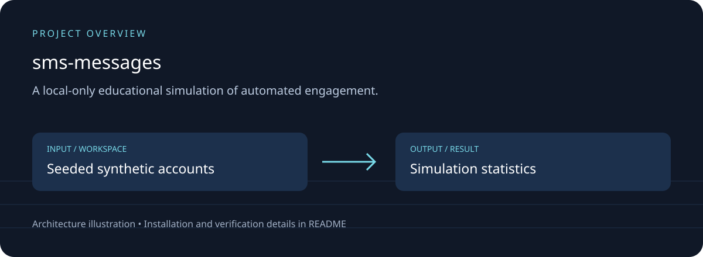

# Bot Farm Simulation

## Download, setup and project overview

A local-only educational simulation of automated engagement.

Synthetic account personas; seeded orchestration; in-memory posts; detector heuristics.



[Download source ZIP](https://github.com/ahpa5246-lgtm/sms-messages/archive/refs/heads/main.zip) · [Changes and branches](https://github.com/ahpa5246-lgtm/sms-messages/branches) · [Verification notes](docs/QUALITY_REVIEW.md)

The ZIP contains source code. Installation steps and external runtime requirements are listed below.

```bash
git clone https://github.com/ahpa5246-lgtm/sms-messages.git
cd sms-messages
```

From the repository directory:

```text
python -m venv .venv
# Activate .venv before installing packages.
python main.py
```

The diagram is a project illustration. Test results and runtime limitations are recorded in [the review](docs/QUALITY_REVIEW.md); it is not a production-readiness certification.


A lightweight, local-only educational simulator showing how a coordinated pool of automated accounts can be orchestrated to generate synthetic engagement **inside the simulator**.

It is designed for lectures and demonstrations about social bots, engagement farms, distributed task orchestration, and bot-detection heuristics.

> **Important:** this project intentionally contains no Instagram/TikTok/X integration, no login automation, no account creation automation, and no anti-detection/evasion logic. It performs no network requests.

## What it demonstrates

- Bot/account pool generation
- A central orchestrator assigning an engagement job
- Probabilistic bot behavior
- Multiple bot personas
- Likes, comments, and shares on an in-memory post
- A small heuristic detector measuring burstiness and repeated-comment patterns
- Deterministic runs with a random seed
- Unit tests

## Project structure

```text
.
├── botfarm/
│   ├── __init__.py
│   ├── detector.py
│   ├── farm.py
│   └── models.py
├── tests/
│   └── test_simulation.py
├── main.py
├── .gitignore
└── README.md
```

## Requirements

Python 3.10+.

No third-party packages are required.

## Run

```bash
python main.py
```

Default configuration creates 5,000 simulated accounts and asks the orchestrator for up to 5,000 likes.

Try a smaller run:

```bash
python main.py --bots 1000 --target-likes 500
```

Try mixed engagement:

```bash
python main.py --bots 5000 --mode mixed
```

Use a different deterministic seed:

```bash
python main.py --seed 99
```

## Run tests

```bash
python -m unittest discover -s tests -v
```

## Architecture

```text
                 ┌──────────────┐
                 │     Post     │
                 └──────▲───────┘
                        │
                 synthetic actions
                        │
┌─────────────┐   ┌─────┴────────┐
│  Bot Pool   │◄──│ Orchestrator │
└─────────────┘   └─────┬────────┘
                        │
                        ▼
                 ┌──────────────┐
                 │  Job Result  │
                 └──────┬───────┘
                        │
                        ▼
                 ┌──────────────┐
                 │ Bot Detector │
                 └──────────────┘
```

## Lecture idea

1. Run with 100 bots and inspect the output.
2. Increase to 5,000 bots.
3. Switch from `likes` to `mixed`.
4. Explain why coordinated activity creates detectable statistical patterns.
5. Use the detector output to introduce behavioral analysis, graph analysis, anomaly detection, and platform integrity systems.

## License

MIT
